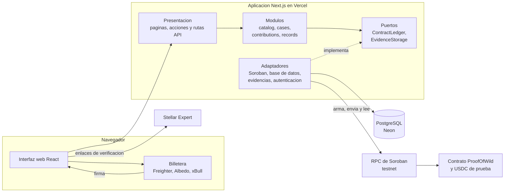
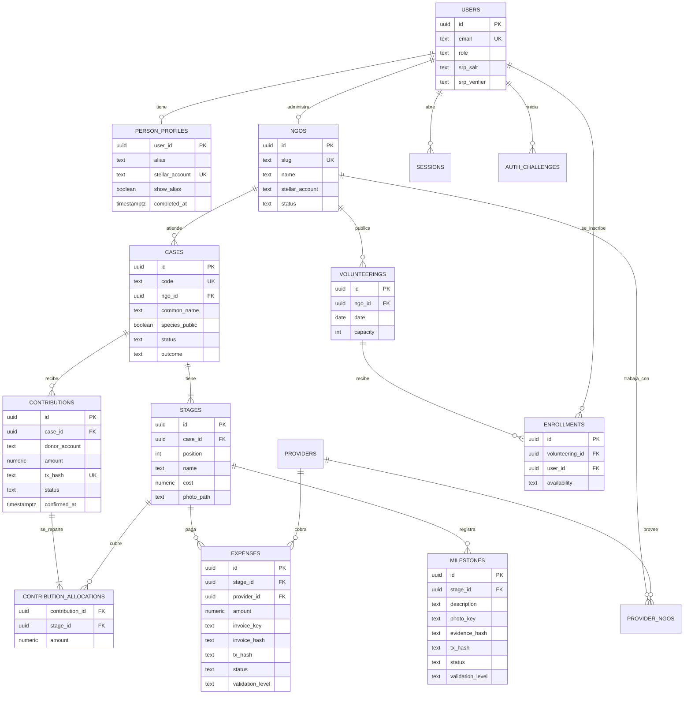
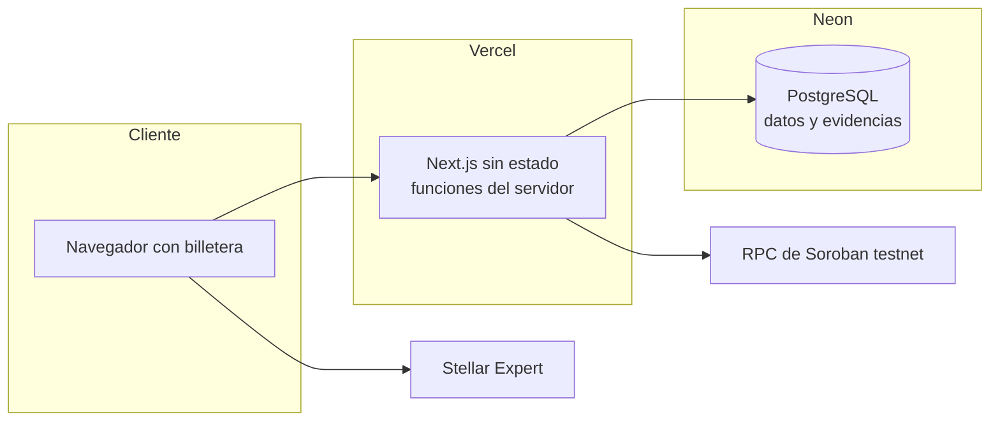

# Proof of Wild · Arquitectura del MVP

Diseño obtenido con ADD 3.0 a partir de los drivers de [`contexto-y-drivers.md`](contexto-y-drivers.md). Vocabulario fijo: **módulo** es una unidad de código con una capacidad de negocio (`modules/contributions`); **puerto** es una interfaz que el dominio necesita del exterior (`ports/`); **adaptador** implementa un puerto contra un sistema externo (`platform/stellar`).

Este documento describe el código actual (rama `feat/rediseno-frontend`, noviembre de 2026). Las decisiones del primer diseño que el brief del 9 de noviembre reemplazó se conservan en la sección 2 como historial.

## 1. Resumen

Proof of Wild es un **monolito modular en capas con puertos y adaptadores**, desplegado como una aplicación Next.js sin estado. Una sola aplicación sirve el sitio público, el perfil del donante, el portal de la ONG y la API. Cada capacidad es un módulo con reglas puras; todo lo que toca la red Stellar o el almacén de evidencias entra por un puerto.

Cuatro ideas sostienen el diseño:

1. **El contrato custodia el dinero y la red es la fuente de verdad.** El contrato `ProofOfWild` (Soroban) guarda los aportes de cada caso, los reparte en orden entre sus etapas y paga al proveedor cuando la ONG registra un gasto. Un aporte, gasto o hito existe para la plataforma solo después de que el servidor lo lee en la red (RN-03).
2. **La base de datos es el modelo de lectura.** Las páginas leen siempre de PostgreSQL; la red solo está en la ruta de escritura. El servidor guarda una copia de cada transacción antes de enviarla (ADR-12).
3. **Nadie le entrega sus llaves a la plataforma.** Donantes y ONG firman con su propia billetera; el servidor arma las transacciones sin firmar y nunca guarda llaves secretas.
4. **Todos tienen cuenta y lo privado no cruza la frontera pública.** Personas y ONG entran con correo y contraseña (SRP-6a); apadrinar exige una cuenta de persona (ADR-16). Las respuestas públicas se construyen con proyecciones explícitas y las fotos pierden sus metadatos al subirlas.

## 2. Decisiones (ADR)

### Vigentes

| ID | Decisión | Drivers | Alternativas descartadas | Costo |
|---|---|---|---|---|
| ADR-01 | Monolito modular en capas con puertos y adaptadores | QA-DEP-01, QA-TST-01, QA-MOD-01, CON-06 | Solo frontend; servicio de base de datos gestionado; microservicios | Más trabajo inicial; escala como una sola unidad |
| ADR-02 | Next.js 16 (App Router) con TypeScript y Tailwind; PostgreSQL con Drizzle ORM | QA-RND-01, RF-COM-01, QA-DEP-01 | SPA pura; Astro; Prisma | El comprobante se renderiza en el servidor para compartirlo; Drizzle es más ligero pero menos «mágico» que Prisma |
| ADR-06 | Las rutas públicas leen solo de la base de datos; la red se consulta para confirmar escrituras | QA-RND-01, QA-DIS-01 | Consultar la red en cada visita | Los datos pueden atrasarse mientras la red confirma |
| ADR-09 | Puertos para todo lo externo. Hoy `ContractLedger` (contrato Soroban) y `EvidenceStorage`; `PaymentRail` y `EvidenceAnchor` quedan como plan B con el adaptador Stellar clásico | QA-MOD-01, CON-07 | Llamar al SDK de Stellar desde los módulos | Una indirección adicional |
| ADR-11 | Contrato `ProofOfWild` en Soroban, ampliado desde `RaizSilvestre`: guarda el dinero de cada caso, reparte cada aporte en orden entre las etapas (rechaza lo que supere la meta) y `registrar_gasto` le paga directo al proveedor desde lo cubierto y sin gastar de una etapa y guarda el hash de la factura; `registrar_hito` guarda el hash de la evidencia. Casos por código `POW_001` (Symbol) | RF-APA-01, RF-GAS-01, RF-HIT-01, QA-TRZ-01, CON-07 | Pago directo a la ONG con memo; una cuenta Stellar por caso | La firma doble (ONG y validador) queda para la etapa 2; hay que redesplegar el contrato si cambia |
| ADR-12 | El servidor guarda una copia de cada transacción con su reparto antes de enviarla (el RPC de Stellar conserva los eventos unos 7 días) y la confirma solo cuando la lee en la red; reenviar la misma transacción bien firmada después de un rechazo la vuelve a intentar | RN-03, QA-DIS-01 | Confiar en lo que informa el navegador | Consistencia eventual mientras la red confirma |
| ADR-13 | Las facturas (con los datos de terceros tapados) y las fotos de los hitos se publican, para que cualquiera compare su hash con el de la red: doble confirmación | QA-TRZ-01, RN-08 | URL firmadas de corta vida | Las facturas deben subirse ya anonimizadas |
| ADR-14 | Todos entran con correo y contraseña (persona u ONG) usando SRP-6a: la base solo guarda sal y verificador, la contraseña nunca viaja. Desafíos de un solo uso de 2 minutos, bloqueo tras 5 fallos en 15 minutos, señuelo para correos inexistentes y sesiones guardadas como SHA-256 del token | QA-SEG-01, QA-SEG-02 | Donantes solo por billetera; contraseña en texto al servidor | Recuperar la contraseña exige un flujo por correo (fuera del MVP) |
| ADR-15 | Script de preparación de testnet (`npm run red:preparar`): cuentas con Friendbot, USDC de prueba y su Stellar Asset Contract, despliegue del contrato, casos y la actividad de los datos de prueba, en minutos | QA-DEP-01, R-02 | Preparar la red a mano | Depende de Friendbot y del RPC público el día que se corre |
| ADR-16 | Apadrinar exige una cuenta de persona con la sesión iniciada. El servidor lo hace cumplir en `/api/aportes/preparar` y `/api/aportes/enviar` (401 sin sesión, 403 con cuenta de ONG o de administrador). Quien llega sin cuenta ve una invitación con el caso, su ruta y la insignia, y al crear la cuenta o ingresar vuelve al caso con la ventana de apadrinar abierta. La billetera queda ligada al perfil con el primer aporte (firmarlo prueba que es suya) | QA-SEG-02, RF-APA-01, RF-PAN-01 | Aportes anónimos solo con billetera | Un paso más antes del primer aporte; se compensa con el regreso automático al caso |
| ADR-17 | Las evidencias (facturas y fotos) se guardan en la base de datos (`evidence_files`) por defecto, para que la app siga sin estado en Vercel y viajen con la base; el disco local queda como opción de desarrollo (`EVIDENCE_STORAGE=local`) | QA-DEP-01, ADR-13 | Almacén de objetos aparte | La base crece con los archivos; suficiente para el volumen del MVP |
| ADR-18 | Despliegue en Vercel con PostgreSQL gestionado en Neon; `main` es producción y cada rama tiene una vista previa privada | QA-DEP-01, CON-06 | Servidor propio; contenedores orquestados | Primera carga lenta cuando Vercel y Neon están dormidos |
| ADR-19 | El estado de cada etapa (completada, en curso, pendiente) se calcula con lo cubierto, igual que el contrato llena las etapas; no se guarda a mano | QA-TRZ-01, RN-01 | Estado escrito por la ONG o la semilla | La columna `stages.status` queda solo como dato de la semilla |
| ADR-20 | Frontend de una sola página principal (Inicio, Cómo funciona, Casos y Voluntariados como secciones con menú de anclas); `/casos`, `/como-funciona` y `/voluntariados` redirigen a su sección desde `next.config.ts`. El sistema visual «Mapa de liberación» está en [`DESIGN.md`](../../DESIGN.md) | QA-USA-01 | Una página por sección | Las secciones comparten una sola carga de datos |
| ADR-21 | Verificación de identidad por niveles (KYC) basada en riesgo: con la cuenta (nivel 1) se apadrina hasta 50 USDC; por encima se exige identidad verificada (nivel 2), que el servidor hace cumplir en `/api/aportes/preparar` (403 `verification_required`). La verificación pide documento, prueba de vida (parpadear y girar la cabeza) y comparación del rostro, que corren en el navegador con `@vladmandic/human`; la consulta al registro pasa por el puerto `IdentityProvider`, hoy con un adaptador simulado. Se guarda solo el resultado: HMAC del documento (un documento no verifica dos cuentas), sus últimos 4 dígitos, el método, la coincidencia, el proveedor y el consentimiento. Las ONG muestran su verificación (KYB) en el perfil, simulada en la demo | QA-SEG-02, QA-SEG-01, CON-05 | KYC obligatorio para todos; librería de Python en un servicio aparte; proveedor real desde el MVP | La biometría hecha en el navegador se puede falsear: en producción la hace el proveedor (Truora, Didit, MetaMap) con el mismo puerto |
| ADR-22 | Plataforma en tres idiomas (español, inglés y portugués de Brasil) con rutas por idioma, como kiba.tools: el español va sin prefijo y el inglés y el portugués con `/en` y `/pt`. `src/proxy.ts` quita el prefijo, reescribe a la ruta sin prefijo, le pasa el idioma a la página en una cabecera y lo recuerda en una cookie (una ruta sin prefijo con la cookie en otro idioma redirige a ese idioma; `/api` toma el idioma de la cookie). Los textos viven en diccionarios por área en `src/i18n/mensajes`, con el español como fuente: el compilador exige las tres traducciones de cada clave. Los errores del dominio siguen en español y se traducen en la frontera (`traducirError`). Lo que escriben las ONG se traduce con ADR-23 | QA-USA-01 | Carpeta `app/[idioma]` (mover todas las rutas); next-intl (una dependencia más); idioma solo por cookie (los enlaces compartidos no llevarían el idioma) | Cambiar de idioma recarga la página completa; cada enlace interno pasa por `ruta()` |
| ADR-23 | Lo que escribe cada ONG (nombre común e historia del caso, nombre y «qué cubre» de cada etapa, descripción de la ONG, hitos, conceptos de gasto y voluntariados) guarda sus traducciones en una columna `translations jsonb` en la misma fila, con la forma `{ en: { campo: texto }, pt: { … } }`. Las columnas de siempre guardan el original. El servicio del catálogo y los repositorios reciben el idioma de la petición (`getIdioma()`) y devuelven cada campo ya resuelto con `traducir()` (`src/i18n/contenido.ts`): la traducción si existe y no está vacía, el original si no. Las proyecciones públicas siguen eligiendo campo por campo, así que la columna no sale de los repositorios. Los datos de prueba traen inglés y portugués de Brasil; `db:seed` y `red:preparar` los guardan y `db:traducciones` los pone en una base ya sembrada | QA-USA-01, QA-SEG-01 | Tabla aparte de traducciones (entidad, campo, idioma, texto): una consulta más por página y más uniones para pocos campos; una columna por idioma (`story_en`, `story_pt`): una migración por idioma nuevo; traducción automática al mostrar: un servicio externo en la ruta de lectura y textos sin revisar | Los textos se traducen a mano: un caso nuevo se ve en su idioma original hasta que alguien escriba la traducción; las búsquedas por texto tendrían que mirar dentro del jsonb |

### Reemplazadas por el brief del 9 de noviembre de 2026

| ID | Decisión original | Reemplazada por |
|---|---|---|
| ADR-03 | Aporte como pago directo a la cuenta de la ONG con memo igual al código del caso | ADR-11 |
| ADR-04 | Confirmar leyendo la transacción en Horizon con reconciliación programada de `pending_contributions` | ADR-12 |
| ADR-05 | Anclar el hash de la evidencia en el memo de un pago mínimo a sí mismo | ADR-11 |
| ADR-07 | Almacén privado de evidencias con URL firmadas | ADR-13, ADR-17 |
| ADR-08 | Donantes solo por billetera, sin cuenta | ADR-14, ADR-16 |
| ADR-10 | Aplicación sin estado, PostgreSQL y almacén de objetos; semillas de 3 casos | ADR-15, ADR-17, ADR-18 (los datos de prueba son ahora 5 casos y 2 ONG) |

### Tecnologías

| Capa | Elección |
|---|---|
| Aplicación | Next.js 16 (App Router, Turbopack), React 19, TypeScript 5, Tailwind CSS 4 |
| Datos | PostgreSQL 16 (Docker en local, Neon en producción), Drizzle ORM y drizzle-kit (migraciones SQL versionadas) |
| Contrato | Rust y Soroban SDK (`contracts/proof-of-wild`), con su Stellar Asset Contract para el USDC de prueba |
| Stellar | `@stellar/stellar-sdk` (RPC de Soroban, Horizon y construcción de transacciones), Stellar Wallets Kit (Freighter, Albedo, xBull, Lobstr, Hana y Rabet en el navegador) |
| Autenticación | `secure-remote-password` (SRP-6a) y sesiones con cookie httpOnly |
| Validación | zod para entradas de API y variables de entorno |
| Imágenes | sharp (re-codifica en WebP y elimina EXIF) |
| Biometría | `@vladmandic/human` en el navegador (detección, malla, antispoof, liveness y descriptor del rostro); modelos servidos desde `public/modelos/human` |
| Pruebas | Vitest (dominio, adaptadores e integración con PostgreSQL real) y una prueba de punta a punta en testnet (`npm run red:probar`) |
| Despliegue | Vercel y Neon; CI en GitHub Actions (tipos, pruebas con PostgreSQL y compilación) |

## 3. Iteraciones de diseño (ADD)

### Iteración 1 · Estructura general

Drivers: CON-06, QA-DEP-01, QA-TST-01, QA-MOD-01, QA-SEG-02.

| Alternativa | Plazo | Reglas de rol y datos privados (QA-SEG) | Testabilidad | Contrato Soroban | Veredicto |
|---|---|---|---|---|---|
| A. Solo frontend con JSON y lectura de la red | Mejor | No cumple: sin servidor no se pueden hacer cumplir roles ni guardar privados | Parcial | Parcial | Descartada |
| B. Frontend con servicio de base de datos gestionado | Muy bueno | Parcial: reglas de acceso en configuración difíciles de probar | Parcial | Parcial: acoplamiento al proveedor | Descartada |
| C. Monolito modular con backend propio | Bueno | Cumple | Cumple | Cumple (puertos) | **Elegida** |
| D. Servicios separados | Malo | Cumple | Cumple | Cumple | Descartada: sin driver de escalabilidad que lo justifique |

Trade-off aceptado: más trabajo que A y B, compensado con la estructura de carpetas y la ausencia de un servicio extra que operar.

### Iteración 2 · Funcionalidad primaria: apadrinar

Drivers: RF-APA-01/02, RF-COM-01, QA-USA-01, RN-03.

- Apadrinar exige una cuenta de persona (ADR-16). Sin sesión, la ventana de apadrinar se reemplaza por una invitación a crear la cuenta o ingresar que vuelve al caso.
- El servidor arma la transacción `aportar` sin firmar, la simula y calcula el reparto previsto por etapa (`allocateContribution`), que la persona ve antes de firmar.
- La billetera firma; el servidor guarda la copia como `enviada`, la envía al RPC y la lee en la red. El reparto que vale es el que devolvió el contrato en su evento, guardado en `contribution_allocations`.
- `contributions.tx_hash` es único: confirmar dos veces no duplica el aporte. Si la red rechaza una firma y luego llega la misma transacción bien firmada, se vuelve a enviar (ADR-12).
- El comprobante se identifica por el hash de la transacción y se renderiza en el servidor con metadatos para compartir.

### Iteración 3 · Trazabilidad e integridad

Drivers: QA-TRZ-01, RF-GAS-01, RF-HIT-01, RF-VAL-01.

- El hash de evidencia es SHA-256 del archivo (factura o foto ya limpia); si el hito no tiene archivo, es SHA-256 del JSON canónico del registro.
- `registrar_gasto` paga al proveedor desde lo cubierto y sin gastar de la etapa y guarda el hash de la factura; `registrar_hito` guarda el hash de la evidencia. El servidor confirma leyendo la invocación en la red.
- Factura, foto y transacción son públicas (ADR-13): cualquiera compara el hash publicado con el del contrato en Stellar Expert.
- Niveles de validación: presentado por la ONG, revisado por un profesional y verificado de forma independiente. En el MVP el nivel lo fija la ONG o la semilla; la validación con firma de un tercero llega en la etapa 2.
- El estado de cada etapa se deriva de lo cubierto (ADR-19), así una etapa «completada» siempre muestra su costo cubierto.

### Iteración 4 · Seguridad y privacidad

Drivers: QA-SEG-01, QA-SEG-02, RN-04 a RN-08.

| Táctica | Dónde se aplica |
|---|---|
| Limit exposure | Proyecciones públicas explícitas en `modules/catalog` y en los repositorios de lectura; los modelos internos nunca se serializan |
| Authenticate actors | SRP-6a (ADR-14): la contraseña nunca sale del navegador; sesiones como hash del token, 8 horas |
| Authorize actors | Rol en el servidor: apadrinar exige persona (ADR-16); el portal y sus rutas exigen una ONG aprobada y solo operan sus propios casos |
| Validate input | zod en cada ruta de API y acción del servidor; códigos de caso y cuentas Stellar con `CHECK` en la base |
| Sanitize | Fotos re-codificadas sin EXIF; solo tipos de archivo permitidos y tamaño máximo |
| Nonrepudiation | Las firmas de donantes y ONG quedan en la red |
| Encrypt data | TLS en tránsito; cifrado en reposo del proveedor (Neon) |

Decisión de menor superficie: la aplicación **no guarda llaves secretas de Stellar**. Las llaves de las cuentas de prueba viven en `.data/cuentas-demo.json` (fuera de git) y solo las usan los scripts de testnet.

### Iteración 5 · Resiliencia

Drivers: QA-DIS-01, QA-RND-01.

- Lectura desde la base de datos (ADR-06). La red solo está en la ruta de escritura.
- Copia antes de enviar (ADR-12): si la red tarda, el aporte queda `enviada` y el navegador consulta `/api/aportes/{hash}`, que vuelve a leer la red hasta confirmarlo o marcarlo `fallida` con su motivo.
- Health check en `/api/health` (con `?deep=1` prueba la base de datos).
- Pantallas de carga, error y estados vacíos en el sitio, para que una lectura lenta no deje la página en blanco.

### Iteración 6 · Modificabilidad

Drivers: QA-MOD-01, CON-07.

- Los módulos solo conocen `ContractLedger` y `EvidenceStorage`. El paso del pago directo al contrato (CON-07) se hizo cambiando el adaptador y los servicios de aportes y registros, sin tocar las reglas de `modules/cases`.
- El adaptador clásico (`PaymentRail`, `EvidenceAnchor`) sigue compilando como plan B si el RPC de Soroban falla el día de la demo.
- Lo siguiente (firma doble, validadores, cierre de caso) cabe en el contrato y en `modules/records` sin cambiar el modelo de lectura.

## 4. Vistas

### 4.1 Contexto

Ver el diagrama de contexto en [`contexto-y-drivers.md`](contexto-y-drivers.md#2-actores-y-sistemas-externos).

### 4.2 Contenedores y componentes



| Elemento | Responsabilidad | Interfaz principal |
|---|---|---|
| Presentación (`app/`) | Página principal única, detalle del caso, perfiles, portal, comprobante, rutas API y acciones del servidor | HTTP |
| `modules/catalog` | Lado de lectura público: catálogo con la ruta de cada caso, detalle, línea de tiempo, transparencia, comprobante y «Tu aporte» | `CatalogService` |
| `modules/cases` | Reglas puras: código de caso, reparto de un aporte entre etapas, lo que falta, progreso y estado de cada etapa | `allocateContribution`, `stageStatusesFromFunding` |
| `modules/contributions` | Aportes: preparar, enviar, confirmar leyendo la red y reconciliar | `ContributionService.prepare`, `submit`, `refresh` |
| `modules/records` | Gastos e hitos de la ONG: subir la evidencia, armar la transacción, enviar y confirmar | `RecordService.prepareExpense`, `prepareMilestone`, `submit`, `refresh` |
| `modules/identity` | Verificación de identidad por niveles: límite por monto, formato del documento, umbrales de la biometría, documento único por cuenta | `IdentityService.verify`, `assertCanContribute`, `remove` |
| `modules/shared` | Errores de dominio, actor de la ONG y utilidades de etapas | — |
| `ports/` | Contratos de lo que el dominio necesita del exterior | `ContractLedger`, `EvidenceStorage`, `IdentityProvider` (y `PaymentRail`, `EvidenceAnchor` del plan B) |
| `platform/identity` | Registro de identidad simulado para la demo (aprueba documentos válidos; los que terminan en 0000 «no aparecen») | `IdentityProvider` |
| `platform/stellar` | Cliente del contrato y adaptador Soroban (`contract-ledger.ts`); adaptador clásico del plan B | `ContractLedger` |
| `platform/db` | Esquema, migraciones, repositorios de lectura y escritura, datos de prueba y semillas | Repositorios |
| `platform/storage` | Evidencias en la base (`db-storage`) o en disco (`local-storage`), limpieza de imágenes y reglas de subida | `EvidenceStorage` |
| `platform/auth` | Registro y SRP-6a, sesiones y roles | `registerAccount`, `startLogin`, `finishLogin`, `findSessionUser` |
| `platform/config` | Variables de entorno validadas con zod | `get…Env` |
| `platform/container.ts` | Raíz de composición: une servicios y adaptadores | `getCatalogService`, `getContributionService`, `getRecordService`, `getIdentityService` |

Rutas API:

| Ruta | Para qué |
|---|---|
| `POST /api/aportes/preparar` | Transacción `aportar` sin firmar y reparto previsto (exige persona; más de 50 USDC exige identidad verificada) |
| `POST /api/aportes/enviar` | Recibe la transacción firmada, guarda la copia, la envía y la confirma; liga la billetera al perfil (exige persona) |
| `GET /api/aportes/{hash}` | Estado de un aporte enviado; vuelve a leer la red |
| `GET /api/casos/{codigo}/mi-aporte` | «Tu aporte» por etapa para la billetera conectada |
| `POST /api/portal/gastos/preparar`, `POST /api/portal/hitos/preparar` | Suben la evidencia y arman `registrar_gasto` o `registrar_hito` (exige ONG aprobada) |
| `POST /api/portal/registros/enviar`, `GET /api/portal/registros/{tipo}/{id}` | Envían y confirman el gasto o el hito |
| `GET /api/evidencias/{clave}` | Sirve una factura o foto pública |
| `GET /api/health` | Salud del servicio y de la base |
| Acciones `verifyIdentity` y `removeIdentity` (`/cuenta/verificar`) | Guardan o borran la verificación de identidad; reciben puntajes, nunca imágenes |

### 4.3 Modelo de datos

En la base viven los datos de dominio, las cuentas y las evidencias; en Stellar, el dinero, los repartos y los hashes. Los montos usan 7 decimales, como Stellar.



Otras tablas: `donors` (alias público de una billetera que aporta), `evidence_files` (facturas y fotos, ADR-17), `identity_verifications` (resultado de la verificación de identidad de una persona, ADR-21: HMAC y últimos 4 del documento, método, coincidencia, proveedor y consentimiento; sin imágenes) y `audit_log` (definida, todavía sin uso). Migraciones: `0000_modelo_mvp`, `0001_evidencias_en_bd`, `0002_verificacion_identidad` y `0003_traducciones_contenido`.

Traducciones del contenido (ADR-23): `ngos`, `cases`, `stages`, `expenses`, `milestones` y `volunteerings` tienen una columna `translations jsonb` (por defecto `{}`) con la forma `{ en: { campo: texto }, pt: { campo: texto } }`; las columnas de texto guardan el original que escribió la ONG.

Estados de una transacción (`contributions`, `expenses`, `milestones`): `enviada` → `confirmada` o `fallida`. Restricciones que la base hace cumplir: hashes únicos y en hexadecimal, cuentas Stellar con formato válido, código de caso `POW_000`, montos y costos positivos, un aporte confirmado siempre tiene fecha y un gasto confirmado siempre tiene transacción.

### 4.4 Flujo de apadrinamiento

```mermaid
sequenceDiagram
  actor D as Donante
  participant UI as Interfaz web
  participant API as Aplicacion web
  participant W as Billetera
  participant R as RPC de Soroban
  participant DB as Base de datos
  D->>UI: pulsa Apadrinar en POW_001
  alt sin sesion de persona
    UI-->>D: invitacion a crear cuenta o ingresar
    D->>UI: crea la cuenta o ingresa (SRP-6a)
    UI-->>D: vuelve al caso con la ventana abierta
  end
  opt aporte de mas de 50 USDC sin identidad verificada
    UI-->>D: pide verificar la identidad
    D->>UI: documento, prueba de vida y rostro (en el navegador)
    UI->>API: puntajes y documento, sin imagenes
    API-->>UI: nivel 2; vuelve al caso con el monto elegido
  end
  D->>UI: elige el monto
  UI->>API: preparar aporte
  API->>R: simula aportar
  API-->>UI: transaccion sin firmar y reparto previsto
  UI->>W: pide firma
  D->>W: revisa y aprueba
  W-->>UI: transaccion firmada
  UI->>API: enviar la transaccion firmada
  API->>DB: guarda la copia como enviada
  API->>R: envia y lee el resultado
  API->>DB: confirmada con el reparto del contrato y billetera ligada al perfil
  API-->>UI: comprobante con enlace a Stellar Expert
```

### 4.5 Flujo de un gasto o un hito

```mermaid
sequenceDiagram
  actor O as ONG
  participant API as Aplicacion web
  participant DB as Base de datos
  participant W as Billetera
  participant R as RPC de Soroban
  O->>API: datos del gasto y factura (o hito y foto)
  API->>API: limpia la imagen y calcula el hash SHA-256
  API->>DB: guarda la evidencia y el registro como enviado
  API-->>O: registrar_gasto o registrar_hito sin firmar
  O->>W: firma con la cuenta de la ONG
  W-->>O: transaccion firmada
  O->>API: envia la transaccion firmada
  API->>R: envia y lee el resultado
  Note over R: registrar_gasto paga al proveedor<br/>y guarda el hash de la factura
  API->>DB: confirmado; visible en la linea de tiempo y la transparencia
```

### 4.6 Despliegue



`main` se despliega a producción en Vercel y cada rama tiene una vista previa privada. Variables de producción: `DATABASE_URL`, `SESSION_SECRET`, `CONTRACT_ID`, `ASSET_CODE`, `ASSET_ISSUER` y `ASSET_CONTRACT_ID`. En local, PostgreSQL corre en Docker (`npm run db:up`) y `npm run red:preparar` deja la red y la base listas.

## 5. Estructura del repositorio y reglas de dependencia

```text
contracts/proof-of-wild/  Contrato Soroban (Rust) y sus pruebas
scripts/                  Red de pruebas (preparar, probar, enviar USDC), imágenes y fotos
src/
  app/            Presentación (Next.js): páginas, layouts, acciones y rutas API
  components/     Interfaz: inicio, casos, huella, mapa (ruta y curvas de nivel),
                  movimiento (aparición al hacer scroll), estados, sitio, billetera
  modules/        Dominio y aplicación por capacidad (cases, catalog, contributions, records, shared)
  ports/          Puertos que el dominio necesita del exterior
  platform/       Adaptadores: db, stellar, storage, auth, config y container.ts
  lib/            Utilidades sin lógica de negocio (montos, hashes, cuentas, explorador)
public/           Fotos de la demo (sin EXIF), fotos por etapa y logo
drizzle/          Migraciones SQL
docs/arquitectura Contexto, drivers y esta arquitectura
tests/            Dominio, adaptadores e integración con PostgreSQL
```

| Regla | Qué impide |
|---|---|
| `modules/` importa solo de `ports/`, `lib/` y otros módulos por su `index.ts` | Que el dominio dependa de Stellar, de la base o de Next.js |
| `platform/` implementa los puertos y los repositorios que declaran los módulos (importa sus tipos), nunca al revés | Dependencias circulares |
| Solo `platform/container.ts` une servicios y adaptadores | Que el cableado se disperse |
| `app/` usa servicios del contenedor y módulos por su `index.ts`; las lecturas simples usan repositorios de `platform/db` | Que la presentación tenga reglas de negocio |

## 6. Trazabilidad

| Driver | Escenario | Decisión | Elementos | Vista | Evidencia |
|---|---|---|---|---|---|
| Promesa del producto | QA-TRZ-01 | ADR-11, ADR-12, ADR-13 | contrato, `modules/contributions`, `modules/records`, `platform/stellar` | 4.4, 4.5 | `npm run red:probar`: 27 comprobaciones en testnet (reparto, pago al proveedor, hashes de factura y foto) |
| Datos sensibles | QA-SEG-01 | ADR-13, ADR-14 | proyecciones de `modules/catalog`, `platform/storage` | 4.2, 4.3 | Pruebas de integración (sin identificadores ni datos personales en lo público) y de EXIF |
| Cuentas y roles | QA-SEG-02 | ADR-14, ADR-16 | `platform/auth`, `app/api/_lib/donante.ts`, portal | 4.4 | Pruebas de SRP y sesiones; 401 y 403 en las rutas de aportes |
| Identidad por niveles | QA-SEG-02, CON-05 | ADR-21 | `modules/identity`, `platform/identity`, `components/identidad` | 4.4 | Pruebas del límite, del documento único, del consentimiento y del rechazo del registro; 403 `verification_required` |
| Demo en red pública | QA-DIS-01 | ADR-06, ADR-12 | lectura desde la base, copia antes de enviar | 4.6 | Pruebas de aportes con reenvío y confirmación tardía |
| Contrato | QA-MOD-01 | ADR-09, ADR-11 | `ports/`, `platform/stellar` | 4.2 | Paso del pago clásico al contrato sin cambios en `modules/cases` |
| Tres idiomas | QA-USA-01 | ADR-22, ADR-23 | `src/proxy.ts`, `src/i18n` | 4.1 | Pruebas de rutas por idioma, del traductor y de que los tres diccionarios tienen las mismas claves y marcas; pruebas de `traducir()` y de integración del contenido de la demo en inglés y portugués |
| Velocidad | QA-TST-01, QA-DEP-01 | ADR-01, ADR-15, ADR-18 | `modules/*`, scripts, Vercel | 5 | 103 pruebas en segundos; despliegue al fusionar en `main` |

## 7. Evaluación ligera (ATAM reducido)

Evaluación hecha por el propio equipo con escenarios y riesgos; no sustituye un ATAM con evaluadores externos.

### Árbol de utilidad

| Atributo | Escenario hoja | (Importancia, Dificultad) |
|---|---|---|
| Trazabilidad | QA-TRZ-01 | (A, M) |
| Seguridad | QA-SEG-01 | (A, M) |
| Seguridad | QA-SEG-02 | (A, B) |
| Disponibilidad | QA-DIS-01 | (A, M) |
| Usabilidad | QA-USA-01 | (A, M) |
| Modificabilidad | QA-MOD-01 | (M, A) |

### Riesgos

| ID | Riesgo | Causa (decisión) | Mitigación |
|---|---|---|---|
| R-01 | Donantes y ONG deben tener una billetera con cuenta de testnet; el día de la demo puede fallar | ADR-11 | Cuentas de demo preparadas; `npm run red:usdc` para fondear billeteras nuevas; ensayo previo |
| R-02 | Lo hecho en la red no se puede borrar: un ensayo deja los casos fuera del estado inicial, y la testnet se reinicia periódicamente | CON-03, ADR-15 | Ensayar con un contrato propio y volver a correr `npm run red:preparar` antes de la demo, actualizando Neon y las variables de Vercel |
| R-03 | Sin recuperación de contraseña | ADR-14 | Ayuda por correo durante la demo; flujo por correo después del MVP |
| R-04 | Un hash no prueba que la factura sea auténtica | RN-10 | Decirlo en la interfaz y en el pitch; niveles de validación visibles |
| R-05 | Si el RPC tarda más que la espera del servidor, el aporte queda `enviada` hasta que alguien vuelva a consultarlo | ADR-12 | El navegador sigue consultando; `reconcile()` existe pero aún no hay tarea programada |
| R-06 | Primera carga lenta cuando Vercel y Neon están dormidos | ADR-18 | Abrir la página unos minutos antes de presentar |
| R-07 | La biometría corre en el navegador: alguien con conocimientos técnicos puede enviar puntajes falsos, y la consulta al registro es simulada | ADR-21 | Decirlo en la demo; en producción el proveedor hace la biometría y la consulta con el mismo puerto |
| R-08 | La cámara puede fallar el día de la demo (permisos, luz o un equipo lento) | ADR-21 | Botón «Simular la verificación (demo)», que queda marcado como simulada |

### Puntos de sensibilidad y trade-offs

| ID | Tipo | Descripción |
|---|---|---|
| S-01 | Sensibilidad | El tiempo de confirmación del RPC determina cuánto espera la persona antes del comprobante (QA-USA-01) |
| S-02 | Sensibilidad | El tamaño de las imágenes y su procesamiento en el servidor afecta el tiempo de subida y el tamaño de la base (ADR-17) |
| T-01 | Trade-off | Leer de la base mejora rendimiento y resiliencia, pero introduce consistencia eventual frente a la red (QA-RND-01, QA-DIS-01 contra QA-TRZ-01) |
| T-02 | Trade-off | Exigir cuenta para apadrinar liga cada aporte a una persona y su perfil, pero añade un paso antes del primer aporte (QA-SEG-02 contra QA-USA-01) |
| T-03 | Trade-off | Firmar con la billetera de cada quien elimina la custodia de llaves, pero exige instalar una billetera (QA-SEG contra QA-USA) |

### No-riesgos

- El dinero lo custodia el contrato: la ONG no puede gastar más de lo cubierto en una etapa ni pagar a una cuenta distinta del proveedor registrado.
- Ningún dato personal ni ubicación se escribe en la red y el servidor no guarda llaves secretas.
- Confirmar un aporte es idempotente por hash de transacción.

### Deuda reconocida

- Sin tarea programada de reconciliación (`CRON_SECRET` está definida pero ninguna ruta la usa).
- `audit_log` existe en el esquema pero nadie escribe en ella.
- Sin rol de validador ni firma doble (etapa 2); los niveles de validación los fija la ONG.
- La verificación de identidad usa un registro simulado y la de las ONG solo se muestra (simulada); falta el adaptador de un proveedor real.
- El límite de 50 USDC se revisa al preparar el aporte; quien arme su propia transacción y llame al contrato directamente no pasa por él.
- Sin recuperación de contraseña ni cierre de caso.
- Un caso, perfil o comprobante que no existe muestra la página «no encontrado» pero responde 200 en vez de 404, porque el sitio ya empezó a transmitir la página mientras cargaba los datos.
